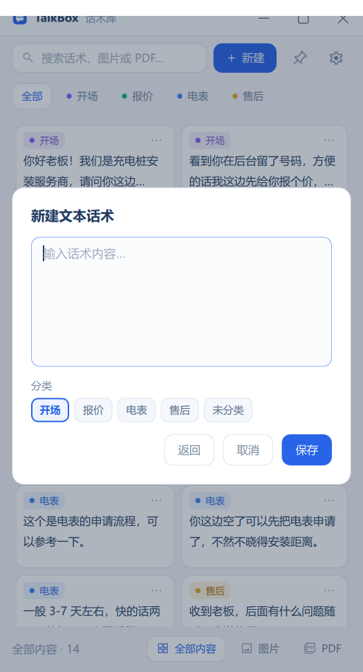
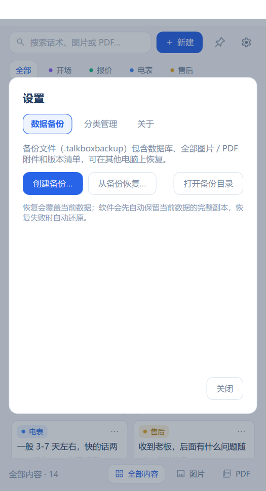

# TalkBOX · 本地话术库

[](https://github.com/Jonxinxin/TalkBOX/releases/latest)
[](#系统要求)
[](#开源许可)

销售和客服每天要反复发送的那些话术，集中放在一个随手可用的面板里：
**文本点一下就复制，图片和 PDF 直接拖进聊天窗口。** 所有数据只存在你的电脑上，
不联网、不需要账号。

<p align="center">
  
  
</p>
<p align="center">
  
</p>

## 功能

- **三种内容**：文本话术、图片、PDF，放在同一个列表里。
- **点击即复制**：文本复制全文，图片复制位图，PDF 复制文件引用，直接 `Ctrl+V` 粘贴到微信等聊天窗口。
- **拖拽发送**：把卡片拖到聊天窗口，文本得到正文，图片 / PDF 作为附件发出去；松手后可以自动按 Enter 发送。
- **快速查找**：搜索正文、分类和文件名；按分类筛选；底部切换全部内容 / 图片 / PDF。
- **分类完全自定义**：没有预置分类，怎么分由你决定；没分类的内容收在「未分类」里。
- **随时整理**：编辑正文、重命名、修改分类、删除，都在卡片右键或「…」菜单里。
- **备份与恢复**：一键导出单个 `.talkboxbackup` 文件，换电脑或重装前先备份。
- **紧凑侧边面板**：默认 420 × 约 780 的竖条窗口，停在屏幕右侧，可以钉在微信旁边一直用。
- **纯本地**：不联网、不上传、无遥测，详见 [`PRIVACY.md`](PRIVACY.md)。

## 下载安装

| 方式 | 说明 |
|---|---|
| **安装版**（推荐） | 从 [Releases](https://github.com/Jonxinxin/TalkBOX/releases/latest) 下载 `TalkBOX-<版本>-setup.exe`，双击安装。当前用户安装，**不需要管理员权限** |
| **免安装版** | 下载 `TalkBOX-portable-<版本>.zip`，解压后双击 `TalkBOX.exe` 即用 |

- 首次启动是空库：直接点右上角「+」新建内容，或先去 `设置 → 分类管理` 建几个分类。
- 卸载程序**不会**删除你的话术库；需要彻底清除时手动删除数据目录（见[数据位置](#数据位置)）。
- 从旧版（PySide6，0.0.x）升级的用户，请先看 [`docs/migrate-from-legacy.md`](docs/migrate-from-legacy.md)。

## 系统要求

- Windows 10 1809+ / Windows 11（x64）
- 无需安装 .NET、Python 或 Qt 运行库，安装包已自带
- 约 60 MB 磁盘占用，另加数据目录

## 快速上手

1. **新建内容**：点右上角「+」，先选文本 / 图片 / PDF，再填写或选择文件。
2. **复制**：单击卡片即可，去聊天窗口 `Ctrl+V`。
3. **拖拽**：按住左键把卡片拖到聊天窗口后松手（拖动不会误触发复制）；勾选[拖拽发送](#拖拽发送)后松手会自动按 Enter。
4. **查找**：顶部搜索框，或按 `Ctrl+K` / `Ctrl+F` 直接跳到搜索。
5. **整理**：右键卡片或点右上角「…」，可预览、编辑、改分类、删除。

### 快捷键

| 按键 | 作用 |
|---|---|
| `Ctrl+N` | 新建内容 |
| `Ctrl+K` / `Ctrl+F` | 聚焦搜索框 |
| `Enter` / `Space` | 复制当前选中的卡片 |
| 方向键 / Home / End / PageUp / PageDown | 在卡片间移动 |
| `Esc` | 关闭弹窗或菜单 |

### 卡片菜单

右键卡片，或点卡片右上角的「…」，菜单会按内容类型显示可用操作：

- **文本**：复制内容、编辑内容、重命名、修改分类、删除
- **图片**：复制图片、预览、打开、在文件夹中显示、重命名、修改分类、删除
- **PDF**：复制文件、打开、在文件夹中显示、重命名、修改分类、删除

删除会二次确认，取消是默认选项；分类被删除时，里面的内容会变成「未分类」并提前告诉你影响多少条。

## 拖拽发送

把卡片拖到聊天窗口后，可以让 TalkBOX 自动按一次 Enter 帮你把消息发出去。提供两种方式：

1. **左键拖拽 + 开关**（默认关闭）
   打开 `设置 → 拖拽发送 → 左键拖拽后自动发送`。开启后，左键拖拽卡片到聊天窗口并松手，就会自动按 Enter。
   开关关闭时，左键拖拽只把内容放进聊天窗口，不会发送。
2. **中键拖拽**（无需开关）
   按住鼠标中键（滚轮按下）拖拽卡片，松手后自动按 Enter 发送。适合不想改设置、只想临时发一条的场景。

说明：

- 只有目标程序**接收了这次拖拽**才会按 Enter；拖回 TalkBOX、拖到空白处或按 `Esc` 取消都不会发送。
- 自动发送通过模拟键盘完成。如果聊天软件以管理员权限运行，Windows 可能拦截模拟按键；此时关掉对方的管理员权限，或手动按 Enter。
- 文本、图片、PDF 三种卡片都适用；发送前请确认拖到的是正确的聊天窗口。

## 分类管理

分类完全由你创建，软件不预置任何分类。

- 入口：`设置（齿轮） → 分类管理`
- 新建、重命名、删除；分类名会自动去首尾空格，并做不区分大小写的重名校验。
- 没有分类的内容会归到虚拟的「未分类」筛选下；新建内容时也可以先不分类，之后随时再改。

## 备份与恢复

入口：`设置 → 数据备份`。

- **备份**：导出单个 `.talkboxbackup` 文件，内含清单、数据库快照和全部附件，适合放到网盘或移动硬盘。
- **恢复**：会先校验文件类型、清单、版本、路径安全和附件完整性，通过后才替换当前数据。
- 替换前会自动把现有数据完整留一份到 `backups/pre-restore-<时间戳>/`；恢复失败会自动回滚，原数据始终可用。

## 数据位置

```text
%LOCALAPPDATA%\TalkBOX\
├─ talkbox.db        # 数据库：话术与分类
├─ attachments\      # 导入的图片 / PDF
├─ backups\          # 备份输出与恢复前的安全副本
├─ logs\talkbox.log  # 运行日志（2 MB 轮换，保留 5 代，不记录话术正文）
└─ ui.ini            # 窗口大小 / 位置 / 置顶状态 / 拖拽自动发送开关
```

- 用环境变量 `TALKBOX_DATA_DIR` 可以把数据目录换到别处（便携使用或测试）。
- 日志只记录启动、迁移、备份恢复等事件，不记录你的话术内容。

## 隐私

TalkBOX 不发起任何网络请求，没有账号、更新检查、崩溃上报或统计。剪贴板只在你点击卡片时写入，
图片 / PDF 只有你主动选择时才会被复制进应用数据目录。完整说明见 [`PRIVACY.md`](PRIVACY.md)。

## 已知限制

- OCR 图片文字搜索、PDF 全文检索、全局快捷键暂未实现。
- 搜索是按子串匹配（SQL `LIKE`），不是分词或模糊搜索。
- 拖拽后自动发送依赖模拟 Enter；目标程序以管理员权限运行时可能被 Windows 拦截。
- 仅提供 x64 构建，32 位与 ARM64 Windows 未验证。
- 从左侧 / 底部拖拽放大窗口时，新露出的边缘可能短暂显示桌面底色，这是 Qt Quick 在 Windows 上的已知行为，已尽量减轻。

## 开源许可

- Qt（LGPL-3.0 / 商业双许可）：发布包内附带 Qt 动态库，可按 LGPL 要求自行替换。
- 图标：Material Symbols（Apache-2.0）、Bootstrap Icons 图钉（MIT），全文见 `LICENSES/`。
- 应用图标 `qml/icons/app.svg` 为本项目自有素材。
- 本仓库源码未附加额外许可声明；如需在他人项目中复用，请先联系作者。

## 反馈

发现问题或有功能建议，欢迎直接开 [Issue](https://github.com/Jonxinxin/TalkBOX/issues)。

<details>
<summary>开发者：从源码构建</summary>

环境：Qt 6.8 MSVC 2022 64-bit、Visual Studio 2022 Build Tools、CMake 3.21+。

```powershell
cmake --preset windows-msvc
cmake --build build/windows-msvc --config Release
ctest --test-dir build/windows-msvc -C Release --output-on-failure

# 开发期运行（需要 Qt 运行库在 PATH 中）
$env:PATH = "C:\Qt\6.8.3\msvc2022_64\bin;$env:PATH"
build\windows-msvc\Release\TalkBOX.exe
```

打包（需要 Inno Setup 6）：`pwsh scripts/package.ps1`，产物在 `dist\`。

架构约定：QML 只做界面，SQL 与业务在 C++（Repository / Service / Model）。
版本号只在 `CMakeLists.txt` 的 `project(... VERSION ...)` 维护。
</details>
